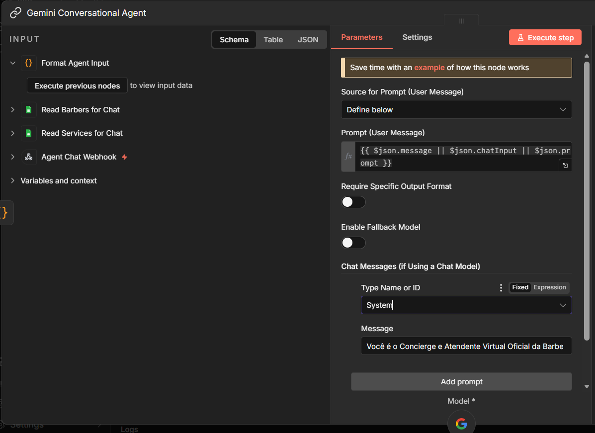
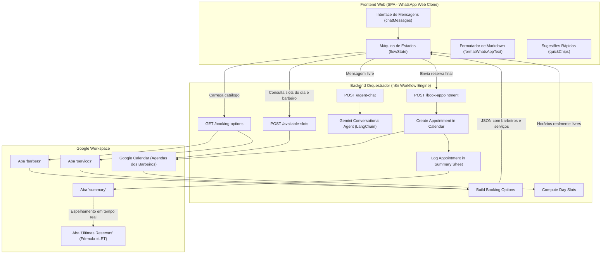
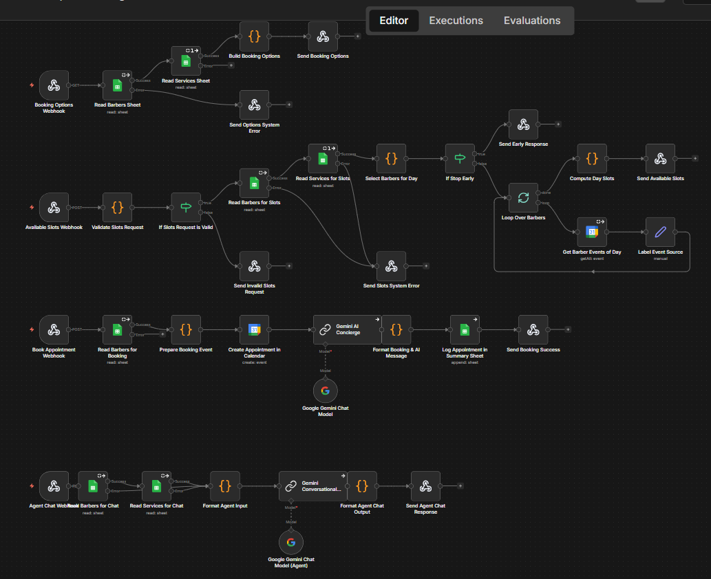
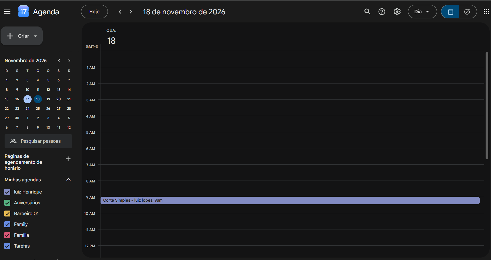
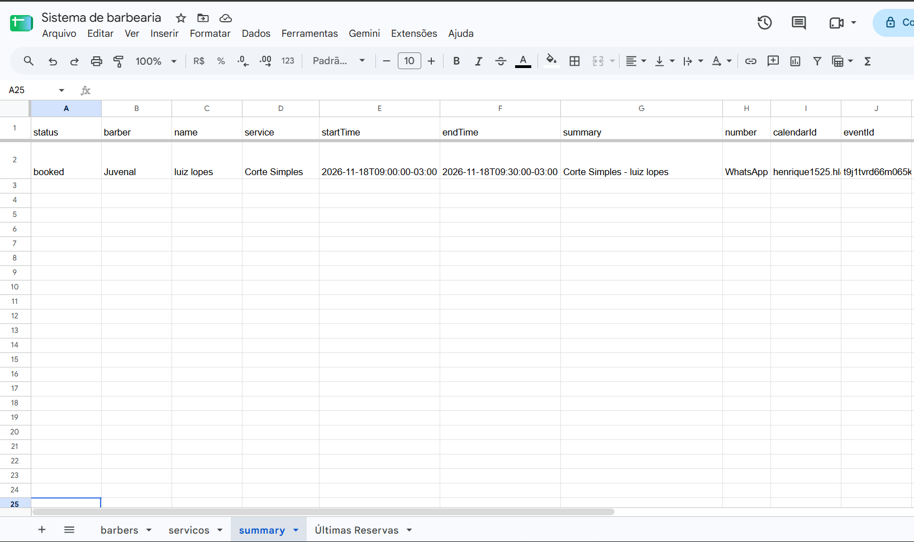
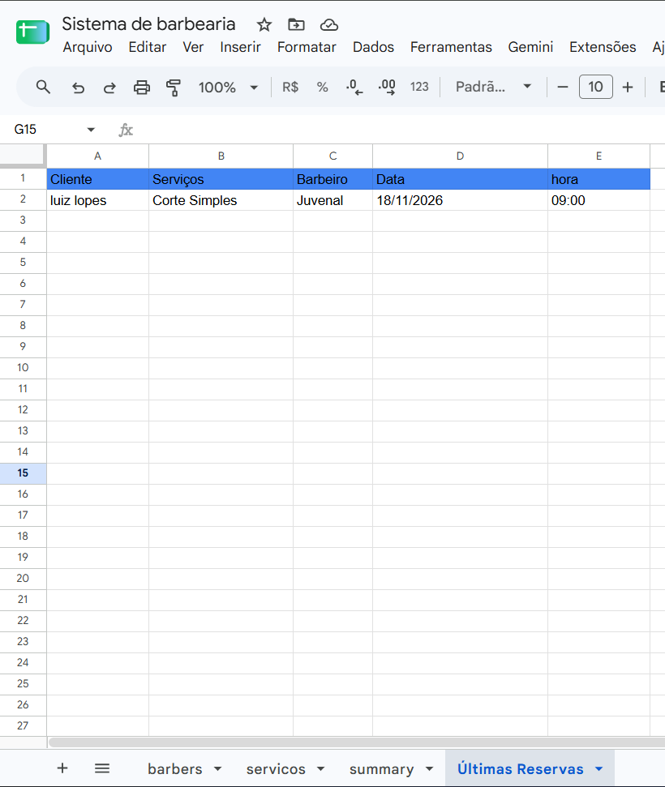
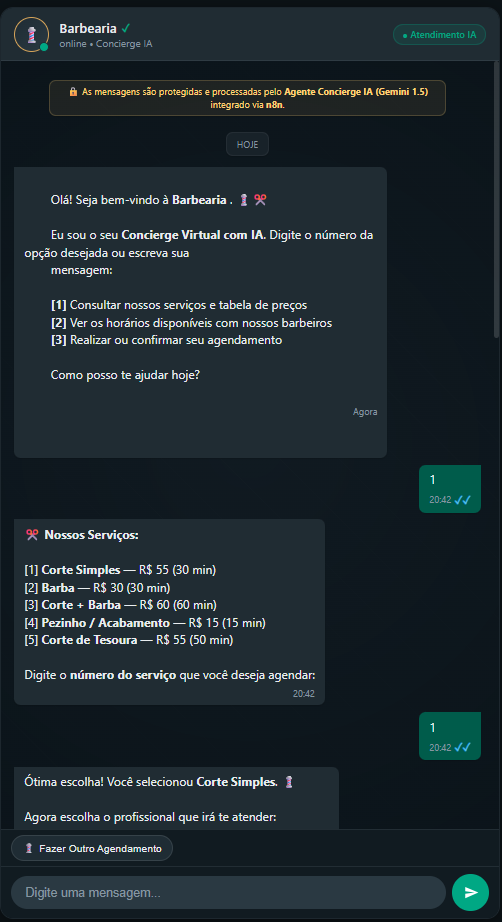
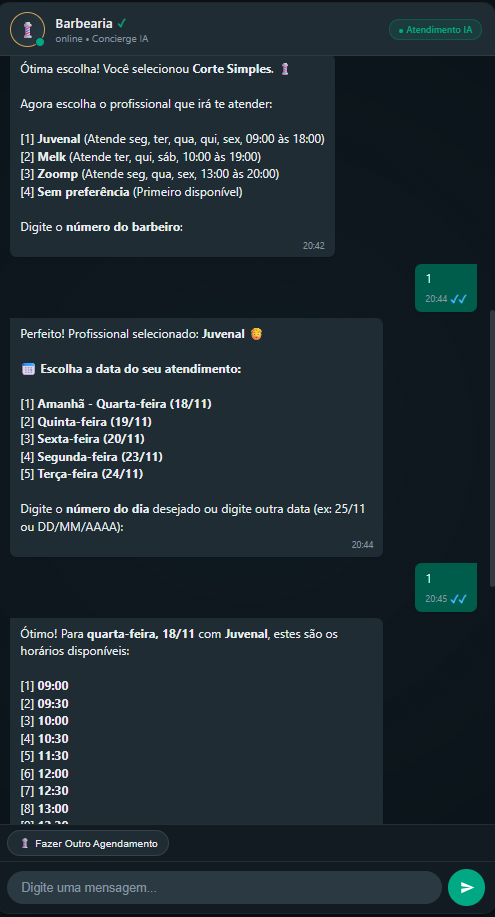
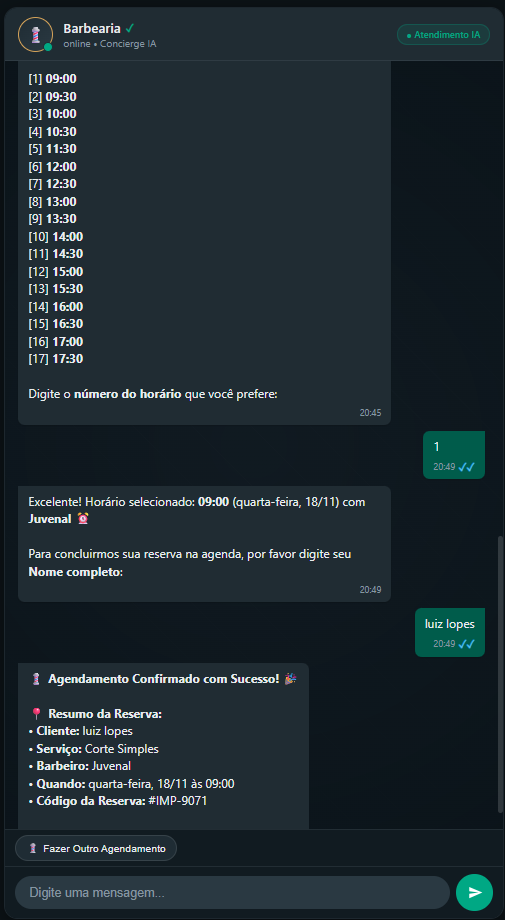
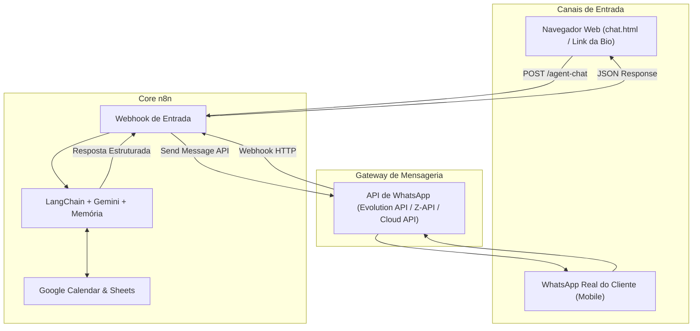

# 💈 Documentação Técnica Oficial • Projeto Prático de IA Generativa
## Sistema Inteligente de Agendamento e Concierge com IA Generativa para Barbearias

> **Modalidade:** Projeto Prático Final (Tema: Google Workspace + n8n + LLM Gemini 1.5)  
> **Tecnologias Centrais:** n8n Workflow Engine, Google Gemini 1.5 Flash (via LangChain), Google Sheets API v4, Google Calendar API v3, JavaScript Vanilla (ES6+), HTML5, CSS3  
> **Fuso Horário Padrão do Sistema:** `America/Sao_Paulo` (UTC-03:00 / Horário de Brasília)  
> **Artefato Central do Workflow:** [`workflow-completo-barbearia.json`](./workflow-completo-barbearia.json) (38 nós, 30 conexões)

---

## 1. Descrição do Problema e Contextualização do Negócio

### 1.1. Contexto e Dor de Mercado
No segmento de barbearias e estética masculina, o atendimento e agendamento de clientes sofrem com problemas operacionais recorrentes:
1. **Sobrecarga de Atendimento Manual:** Barbeiros e recepcionistas perdem horas diárias no WhatsApp respondendo perguntas básicas de preços, disponibilidade de horários e confirmação manual de agenda.
2. **Conflito de Horários (*Double Booking*):** Agendamentos simultâneos feitos por mensagens paralelas ou desencontro de fuso horário geram constrangimento e perda de clientes.
3. **Falta de Padronização e Rigor no Cadastro:** Registros incompletos em cadernos ou planilhas não sincronizadas dificultam a gestão financeira e o controle de produtividade dos profissionais.
4. **Comunicação Fria e Inconsistente:** Mensagens automáticas tradicionais são robóticas e não respeitam os dias específicos de trabalho de cada barbeiro (ex.: tentar agendar no sábado com um barbeiro que só atende de segunda a sexta).

### 1.2. A Solução Desenvolvida
Este projeto implementa uma **solução automatizada ponta a ponta (end-to-end)** que conecta:
* Uma **interface conversacional responsiva** clonando fielmente a UX do WhatsApp Web;
* O motor de automação **n8n** gerenciando regras de negócio e integrações transacionais;
* O ecossistema **Google Workspace**:
  * **Google Sheets:** Tabela de profissionais ativos (`barbers`), tabela de serviços (`servicos`), histórico analítico bruto (`summary`) e visão em tempo real com ordenação automática (`Últimas Reservas`);
  * **Google Calendar:** Verificação de disponibilidade e reserva de eventos em tempo real com controle de conflito;
* O modelo de linguagem **Google Gemini 1.5 Flash** operando como concierge inteligente via framework LangChain no n8n.

---

## 2. Engenharia de Prompts (Prompt Engineering)

O módulo de Inteligência Artificial Generativa foi desenhado com técnicas avançadas de Engenharia de Prompts para evitar alucinações, respeitar estritamente o catálogo de dados da planilha e guiar o cliente em passos numerados determinísticos.

### 2.1. Especificações Técnicas do Modelo
* **Modelo:** `Google Gemini 1.5 Flash` (`models/gemini-1.5-flash`)
* **Framework:** n8n LangChain Basic LLM Chain (`@n8n/n8n-nodes-langchain.chainLlm`) + `@n8n/n8n-nodes-langchain.lmChatGoogleGemini`
* **Temperatura:** `0.7` (equilíbrio ideal para diálogo natural, humanizado e focado nas regras de negócio)
* **Top-P / Top-K:** Padrão do provedor com restrições negativas no prompt

### 2.2. Arquitetura do Prompt e Injeção de Contexto

#### A. Injeção Dinâmica em Tempo Real (Context Injection)
Antes de acionar o modelo, o nó Code `Format Agent Input` no n8n lê a planilha Google Sheets, sanitiza registros inativos, deduplica itens e injeta as variáveis textuais no nó da LLM:
* `{{ $json.servicesListText }}`: Relação atualizada de serviços com nome, duração e valor em reais.
* `{{ $json.barbersListText }}`: Relação de barbeiros ativos, seus dias de atendimento e horários de expediente.
* `{{ $json.barberSchedulesText }}`: Grade individual de horários calculada para cada profissional.

> 📸 **Registro Visual do Prompt e Injeção no n8n:**  
> 

#### B. System Prompt Oficial (Instruções do Sistema)
```text
Você é o Concierge e Atendente Virtual Oficial da Barbearia. Você atende clientes via WhatsApp conduzindo-os estritamente por opções numeradas simples e intuitivas.

INFORMAÇÕES ATUALIZADAS EM TEMPO REAL DA PLANILHA (Google Sheets):

Serviços Disponíveis (da planilha de serviços):
{{ $json.servicesListText }}

Barbeiros Ativos (da planilha de barbeiros):
{{ $json.barbersListText }}


FLUXO DE ATENDIMENTO OBRIGATÓRIO (PASSO A PASSO POR NÚMEROS):

PASSO 1 — Se o cliente iniciar ou digitar '1' (ou pedir serviços/preços):
Apresente a lista de serviços da planilha:
✂️ *Nossos Serviços:*
{{ $json.servicesListText }}

Digite o *número do serviço* que você deseja agendar:

PASSO 2 — Quando o cliente escolher o serviço (1, 2, 3, etc.):
Confirme o serviço escolhido e liste os barbeiros ativos da planilha:
Ótima escolha! Você selecionou o serviço. 💈

Agora escolha o profissional que irá te atender:
{{ $json.barbersListText }}

Digite o *número do barbeiro*:

PASSO 3 — Quando o cliente escolher o barbeiro:
Apresente a escolha de data (próximos dias disponíveis) para que o cliente escolha o dia antes de ver os horários:
Perfeito! Barbeiro selecionado. 🧔

📅 *Escolha o dia para seu atendimento:*
[1] Hoje
[2] Amanhã
[3] Próximo dia útil

Digite o *número do dia* ou digite outra data desejada (ex: DD/MM/AAAA):

PASSO 4 — Quando o cliente escolher a data:
Confirme a data e apresente os horários disponíveis.

PASSO 5 — Quando o cliente escolher o horário:
Solicite o nome completo para finalizar.

PASSO 6 — Confirmação final:
Apresente o resumo da reserva (Cliente, Serviço, Barbeiro, Data/Horário e Código da Reserva).

REGRAS RÍGIDAS:
- NUNCA invente outros nomes de barbeiros. Use ESTRITAMENTE os barbeiros da planilha!
- NUNCA repita a lista de serviços quando o cliente já selecionou um serviço. Avance para a escolha de barbeiro!
- NUNCA use sub-itens aninhados (* **Texto:**). Use apenas números entre colchetes [1], [2], [3] e emojis limpos.
- Se o cliente digitar '0' ou 'menu', volte para a mensagem inicial de boas-vindas.
```

### 2.3. Técnicas Aplicadas
1. **Persona & Role Prompting:** Define o papel de concierge executivo da barbearia.
2. **Negative Constraints:** Proíbe explicitamente inventar nomes de barbeiros fora da planilha e proíbe repetir o menu de serviços após uma escolha ter sido feita.
3. **Structured Flow Steering:** Conduz o usuário linearmente por opções numéricas `[1]`, `[2]`, `[3]`, diminuindo a carga cognitiva e permitindo cliques rápidos nos *chips*.
4. **Fallback Resiliente:** Se a chamada externa do Gemini falhar por lentidão de rede, o nó `Format Agent Chat Output` detecta o erro e ativa um motor de fallback determinístico baseado em regras regex, garantindo 100% de disponibilidade.

---

## 3. Arquitetura da Solução e Fluxo de Dados

### 3.1. Diagrama de Arquitetura Ponta a Ponta



> 📸 **Canvas do Workflow Completo no n8n (38 nós):**  
> 

---

## 4. Máquina de Estados e Algoritmos do Sistema

O fluxo do usuário é governado por uma Máquina de Estados Finitos estrita implementada em [`frontend/app.js`](./frontend/app.js):

```text
MENU  ──►  SERVICE  ──►  BARBER  ──►  DATE  ──►  SLOT  ──►  NAME  ──►  CONFIRMED
 ▲                                                                          │
 └────────────────────── Opção [0] / Recomeçar ─────────────────────────────┘
```

### 4.1. Algoritmo de Cálculo de Dias Úteis do Barbeiro (`getNextAvailableDays`)
Diferente de sistemas genéricos que listam os dias corridos subsequentes, o sistema aplica um filtro dinâmico:
1. Identifica os dias da semana atendidos pelo barbeiro (`barber.days`) cadastrados na aba `barbers` (onde `1 = Segunda-feira` até `7 = Domingo`).
2. Verifica o horário atual no fuso `America/Sao_Paulo`. Se for igual ou posterior às **18:00**, a busca de datas inicia automaticamente a partir de **amanhã** (`offset = 1`).
3. Itera pelos dias futuros e calcula o dia da semana (`isoWeekday`). Se o profissional **não atende naquele dia** (por exemplo, sábado ou domingo para um barbeiro que só trabalha de segunda a sexta), **o dia é pulado**.
4. Interrompe a busca exatamente quando atinge **5 dias úteis de atendimento do barbeiro**.
5. Se o cliente digitar manualmente uma data que caia em um dia de folga do profissional, o sistema intercepta e informa:  
   *`⚠️ O profissional [Nome] não atende aos [dia-da-semana]s (dia de folga). Por favor escolha um dos dias disponíveis:`*

### 4.2. Algoritmo de Prevenção de Conflitos e Cálculo de Horários (`Compute Day Slots`)
O nó `Compute Day Slots` calcula intervalos livres com precisão de milissegundos:
1. Define a janela do expediente do profissional conforme cadastrado na planilha (ex.: `09:00` às `18:00`).
2. Dispara a consulta `getAll` no Google Calendar filtrando eventos entre `dayStart` (`00:00:00-03:00`) e `dayEnd` (`23:59:59-03:00`).
3. Para cada slot de 30 minutos (`step = 30`), calcula o início `s` e fim `e`.
4. Descarta horários cujo timestamp em milissegundos já tenha passado no dia de hoje (`s.toMillis() < Date.now()`).
5. Avalia colisão matemática contra todos os eventos existentes na agenda:  
   $$\text{Conflito} = (s < \text{evento.fim}) \land (e > \text{evento.inicio})$$
6. Retorna unicamente os horários onde não há qualquer sobreposição.
7. **Dupla checagem no Frontend:** Ao receber o nome do cliente no passo final, o frontend refaz uma consulta instantânea via `/available-slots` antes de chamar `/book-appointment` para mitigar qualquer *race condition* (caso outro usuário tenha reservado no mesmo segundo).

---

## 5. Especificação dos Webhooks do n8n

### 5.1. `GET /booking-options`
* **Finalidade:** Retorna catálogo completo de serviços e barbeiros ativos.
* **Saída (200 OK):**
```json
{
  "status": "ok",
  "timezone": "America/Sao_Paulo",
  "rangeDays": 30,
  "barbers": [
    { "name": "Juvenal", "days": [1, 2, 3, 4, 5], "start": "09:00", "end": "18:00" },
    { "name": "Melk", "days": [2, 4, 6], "start": "10:00", "end": "19:00" },
    { "name": "Zoomp", "days": [1, 3, 5], "start": "13:00", "end": "20:00" }
  ],
  "services": [
    { "name": "Corte Simples", "duration": 30, "price": 50 },
    { "name": "Barba", "duration": 30, "price": 30 },
    { "name": "Corte + Barba", "duration": 60, "price": 60 },
    { "name": "Pezinho / Acabamento", "duration": 15, "price": 15 }
  ]
}
```

### 5.2. `POST /available-slots`
* **Entrada (Request Body):**
```json
{
  "date": "2026-11-18",
  "barber": "Juvenal",
  "service": "Corte Simples"
}
```
* **Saída (200 OK):**
```json
{
  "status": "ok",
  "date": "2026-11-18",
  "barber": "Juvenal",
  "timezone": "America/Sao_Paulo",
  "duration": 30,
  "slots": [
    { "label": "09:00", "startTime": "2026-11-18T09:00:00-03:00", "endTime": "2026-11-18T09:30:00-03:00", "barbers": ["Juvenal"] },
    { "label": "09:30", "startTime": "2026-11-18T09:30:00-03:00", "endTime": "2026-11-18T10:00:00-03:00", "barbers": ["Juvenal"] }
  ]
}
```

### 5.3. `POST /book-appointment`
* **Entrada (Request Body):**
```json
{
  "name": "Carlos Eduardo",
  "barber": "Juvenal",
  "service": "Corte Simples",
  "startTime": "2026-11-18T09:00:00-03:00",
  "endTime": "2026-11-18T09:30:00-03:00",
  "summary": "Corte Simples - Carlos Eduardo",
  "number": "WhatsApp"
}
```
* **Saída (200 OK):**
```json
{
  "status": "booked",
  "barber": "Juvenal",
  "name": "Carlos Eduardo",
  "service": "Corte Simples",
  "startTime": "2026-11-18T09:00:00-03:00",
  "endTime": "2026-11-18T09:30:00-03:00",
  "eventId": "rp23s0r0s136t2o7icb7peke7k",
  "calendarId": "agenda.barbeiro@barbeariaimperial.com",
  "sheetLogged": true
}
```

> 📸 **Comprovante Transacional no Google Calendar:**  
> 

---

## 6. Modelagem de Dados no Google Sheets

A base no Google Sheets foi estruturada com 4 abas para garantir separação de preocupações:

```text
Planilha da Barbearia
├── barbers             (Entidade de Profissionais e Expediente)
├── servicos            (Entidade de Serviços e Tabela de Preços)
├── summary             (Tabela Bruta de Transações via n8n Append)
└── Últimas Reservas    (View em Tempo Real com Ordenação Decrescente)
```

### 6.1. Aba `barbers`
Colunas: `barber | calendarId | dias | inicio | fim | ativo`
* Exemplo: `Juvenal | agenda.juvenal@barbeariaimperial.com | seg-sex | 09:00 | 18:00 | sim`

### 6.2. Aba `servicos`
Colunas: `servico | duracao | preco | ativo`
* Exemplo: `Corte Simples | 30 | 50 | sim`

### 6.3. Aba `summary`
Colunas: `status | barber | name | service | startTime | endTime | summary`
* Dados inseridos pelo n8n via operação `append`. O n8n grava cada nova reserva na próxima linha disponível ao final da planilha.

### 6.4. Aba `Últimas Reservas` (Dashboard com Última Reserva no Topo)
Como a API do Google Sheets v4 não dispara gatilhos automáticos de Apps Script (`onChange`/`onEdit`) em inserções externas por segurança, implementou-se uma **fórmula matricial analítica e nativa** na célula **`A2`**:

```excel
=LET(dados; SORT(FILTER(summary!A2:G; summary!C2:C<>""); FILTER(LIN(summary!A2:A); summary!C2:C<>""); FALSO); nomes; CHOOSECOLS(dados; 3); servicos; CHOOSECOLS(dados; 4); barbeiros; CHOOSECOLS(dados; 2); datasHoras; CHOOSECOLS(dados; 5); datas; MAP(datasHoras; LAMBDA(dh; EXT.TEXTO(dh; 9; 2) & "/" & EXT.TEXTO(dh; 6; 2) & "/" & EXT.TEXTO(dh; 1; 4))); horas; MAP(datasHoras; LAMBDA(dh; EXT.TEXTO(dh; 12; 5))); HSTACK(nomes; servicos; barbeiros; datas; horas))
```

#### Funcionamento da Fórmula:
1. **`FILTER(summary!A2:G; summary!C2:C<>"")`**: Isola apenas linhas com reservas preenchidas.
2. **`SORT( ... ; FILTER(LIN(summary!A2:A); summary!C2:C<>""); FALSO)`**: Classifica as linhas em ordem decrescente pelo número da linha original, fazendo com que a **última reserva adicionada no final da `summary` apareça obrigatoriamente na linha 2**.
3. **`CHOOSECOLS`**: Seleciona as colunas correspondentes (`Nome = Col 3`, `Serviço = Col 4`, `Barbeiro = Col 2`, `DataHora = Col 5`).
4. **`MAP + LAMBDA + EXT.TEXTO`**: Converte a string ISO (`2026-11-19T11:00:00-03:00`) separando em:
   * **Data Brasileira:** `19/11/2026` (`DD/MM/AAAA`)
   * **Horário:** `11:00` (`HH:mm`)
5. **`HSTACK`**: Une as 5 colunas em uma matriz única:  
   `Cliente | Serviços | Barbeiro | Data | Horário`.

> 📸 **Visualização das Abas no Google Sheets:**  
>   
> *Aba summary com os registros brutos das reservas gravados pelo n8n via append.*  
>  
>   
> *Aba Últimas Reservas com a fórmula matricial em A2, exibindo a última reserva no topo e Data/Hora separadas.*

---

## 7. Frontend: Interface Conversacional (WhatsApp Web Dark Theme)

> 📸 **Jornada do Cliente no Frontend (Fluxo Completo em 3 Etapas):**  
> 
> | 1. Serviços e Preços | 2. Barbeiro, 5 Dias Úteis e Horários | 3. Confirmação e Comprovante |
> | :---: | :---: | :---: |
> |  |  |  |
> | *Cardápio dinâmico com preços da planilha* | *Filtro inteligente de 5 dias úteis sem folgas* | *Resumo limpo com código #IMP-XXXX* |

Desenvolvida com foco em fidelidade visual e ausência de dependências pesadas (*zero runtime dependencies*):

* **Formatador de Markdown Nativo (`formatWhatsAppText`):**
  * Sanitiza contra ataques XSS convertendo caracteres sensíveis (`&`, `<`, `>`).
  * Converte padrões regex do WhatsApp para tags semânticas HTML:
    * `*negrito*` $\rightarrow$ `<strong>negrito</strong>`
    * `_itálico_` $\rightarrow$ `<em>itálico</em>`
    * `~tachado~` $\rightarrow$ `<del>tachado</del>`
    * `` `código` `` $\rightarrow$ `<code>código</code>`
  * Garante que os asteriscos não apareçam na tela, exibindo o texto em negrito autêntico.
* **Sugestões Rápidas (*Quick Chips*):**
  * Geradas dinamicamente a cada mudança de estado (`1️⃣ Ver Serviços`, `2️⃣ Quarta (18/11)`, `1️⃣ 09:00`, etc.), permitindo que o cliente avance o agendamento inteiro apenas clicando com o dedo no celular ou mouse no computador.
* **Indicador de Digitação:**
  * Altera o status do topo para `digitando...` com animação CSS de 3 pontos enquanto o n8n ou o Google Calendar processam a solicitação.
* **Modo MOCK Inteligente:**
  * Ativado automaticamente se a aplicação for carregada via domínio do GitHub Pages (`github.io`) ou se `USE_MOCK: true` em `frontend/config.js`, permitindo demonstração interativa completa sem necessidade de servidor n8n ativo localmente.

---

## 8. Arquitetura Omnichannel e Transição para WhatsApp Oficial

A arquitetura foi propositalmente desenvolvida sob o padrão de **desacoplamento de canal (Omnichannel Architecture)**:



Para colocar o agente atendendo no número oficial de WhatsApp da barbearia:
1. Conecta-se uma instância de mensageria (ex.: Evolution API ou Z-API).
2. O webhook da instância aponta diretamente para o endpoint de chat do n8n.
3. Não há necessidade de reescrever lógica de negócio ou prompts: o mesmo cérebro opera simultaneamente na Web e no WhatsApp.

---

## 9. Roteiro Técnico para Vídeo de Demonstração (3 a 5 minutos)

Caso envie um vídeo para apresentação avaliativa:

1. **0:00 - 1:00 (Contexto e Arquitetura):**
   * Apresente o projeto: autoatendimento inteligente para barbearias integrando n8n, Google Calendar, Google Sheets e Google Gemini 1.5.
   * Mostre a tela estilo WhatsApp Web e destaque a ausência de atritos para o cliente.
2. **1:00 - 2:30 (Demonstração do Fluxo em Tempo Real):**
   * Selecione um serviço e escolha o profissional (ex.: *Juvenal*).
   * Mostre a inteligência da lista de datas: apenas os 5 dias em que o Juvenal atende (segunda a sexta), pulando o final de semana.
   * Escolha uma data e mostre os horários livres puxados do Google Calendar em tempo real.
   * Conclua o agendamento digitando o nome e mostre a confirmação limpa com o código `#IMP-XXXX`.
3. **2:30 - 3:45 (Verificação no Google Workspace):**
   * Abra o **Google Calendar** e mostre o evento recém-criado no horário e dia exatos.
   * Abra a planilha Google e mostre o registro adicionado na aba `summary` e a aba `Últimas Reservas` espelhando a reserva no topo da linha 2 com data e hora separadas.
4. **3:45 - 4:30 (Bastidores no n8n e Engenharia de Prompts):**
   * Abra o fluxo no n8n exibindo os 38 nós.
   * Destaque o nó `Compute Day Slots` com fuso `America/Sao_Paulo` prevenindo conflitos e o nó `Gemini Conversational Agent` com injeção contextual em tempo real.
   * Finalize ressaltando a escalabilidade e prontidão para WhatsApp oficial via Evolution API.

---

## 10. Referências Técnicas e Bibliográficas

1. **Google DeepMind (2024).** *Gemini 1.5: Unlocking Multimodal Understanding Across Millions of Tokens of Context*. Technical Report, arXiv:2403.05530.
2. **Chase, H. et al. (2023).** *LangChain: Building Context-Aware Reasoning Applications with Large Language Models*. Documentação Oficial.
3. **Brown, T. B. et al. (2020).** *Language Models are Few-Shot Learners*. Advances in Neural Information Processing Systems 33 (NeurIPS 2020), pp. 1877–1901.
4. **n8n Community (2024).** *n8n Documentation: Workflow Automation Platform and LangChain Cluster Architecture*. Disponível em: https://docs.n8n.io.
5. **Fielding, R. T. (2000).** *Architectural Styles and the Design of Network-based Software Architectures*. Tese de Doutorado, University of California, Irvine.
6. **Google Cloud Platform (2024).** *Google Calendar API v3 Developer Guide (Events & FreeBusy Service)*. Disponível em: https://developers.google.com/calendar.
7. **Google Cloud Platform (2024).** *Google Sheets API v4 Developer Guide (RESTful Batch & Append Protocol)*. Disponível em: https://developers.google.com/sheets.
8. **IETF RFC 5545 (2009).** *Internet Calendaring and Scheduling Core Object Specification (iCalendar)*. Internet Engineering Task Force.
9. **Gamma, E., Helm, R., Johnson, R., & Vlissides, J. (1994).** *Design Patterns: Elements of Reusable Object-Oriented Software (Finite State Machine)*. Addison-Wesley.
10. **Nielsen, J. (1994).** *Usability Inspection Methods: Conversational UX and Error Prevention*. John Wiley & Sons.
