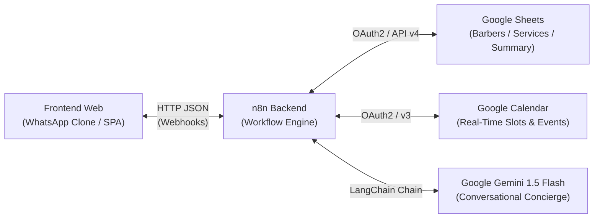
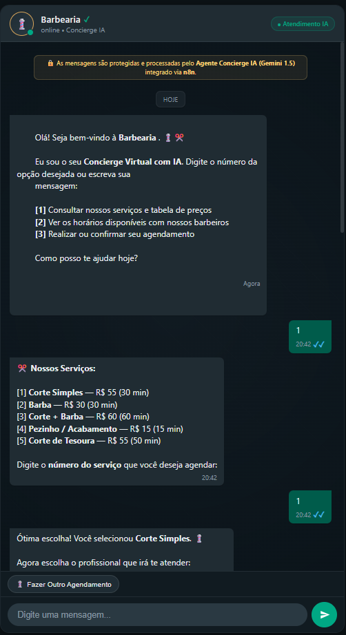
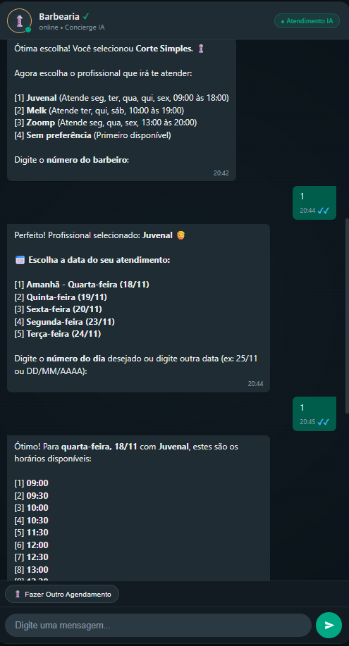
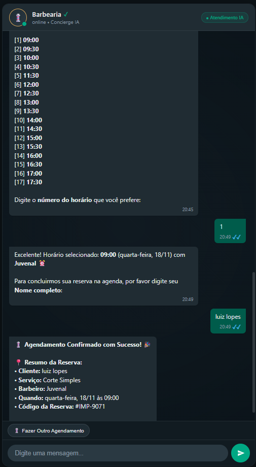
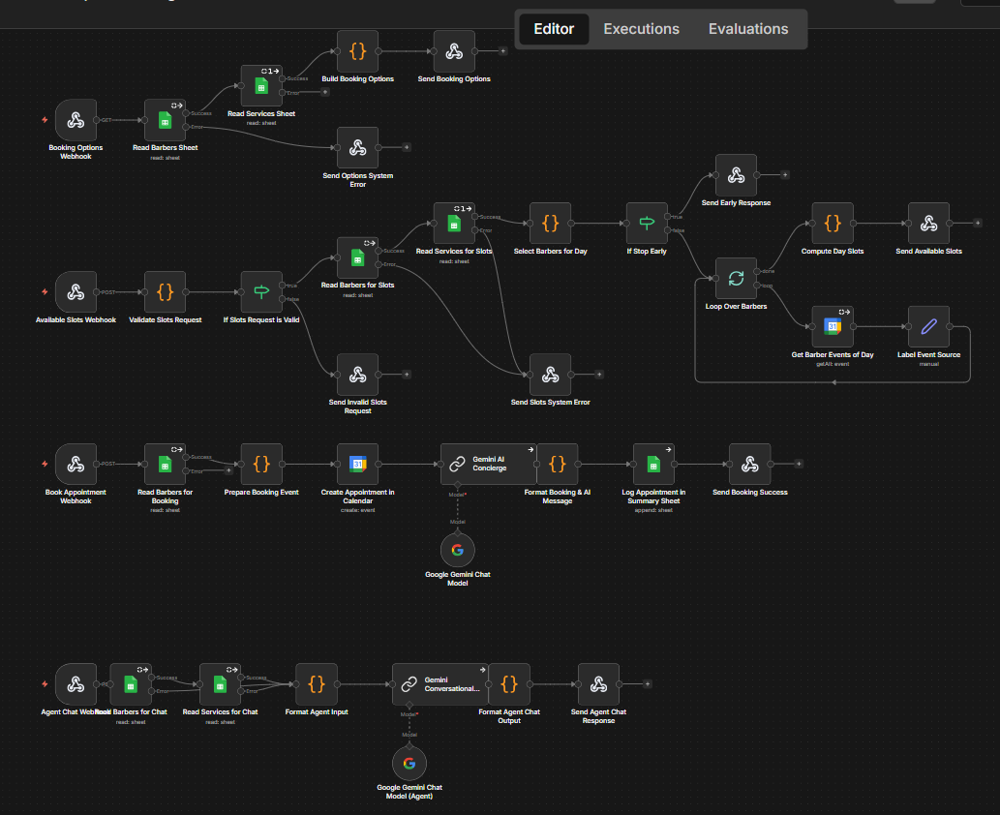
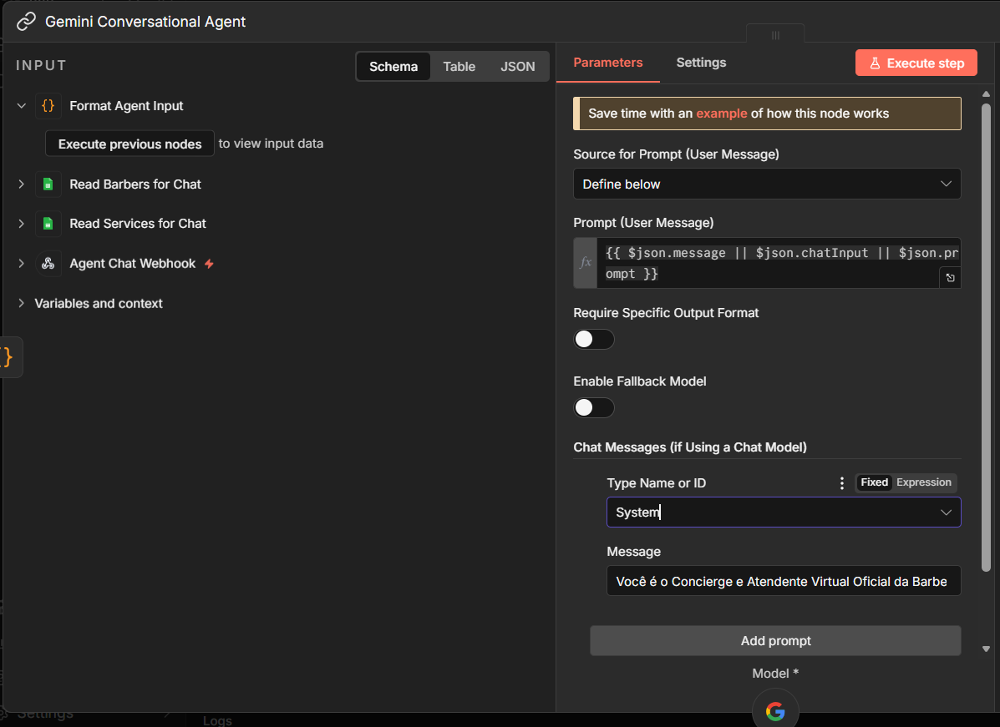
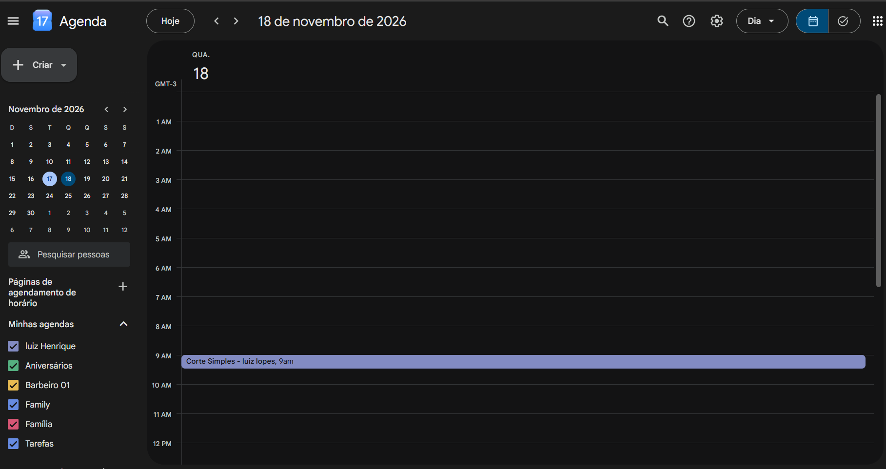
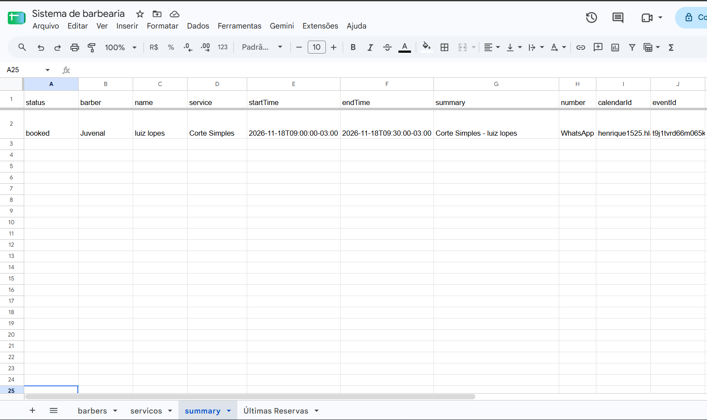
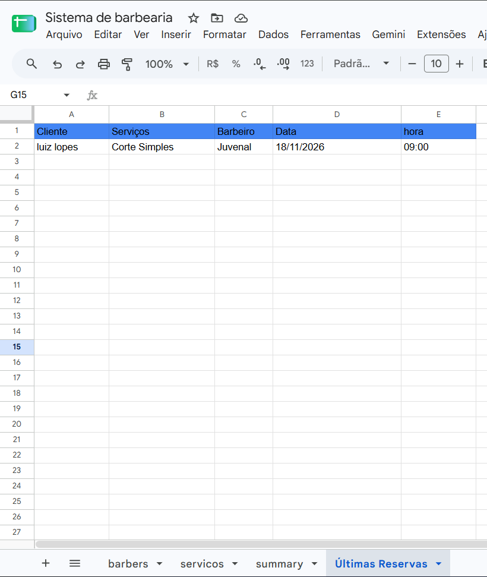
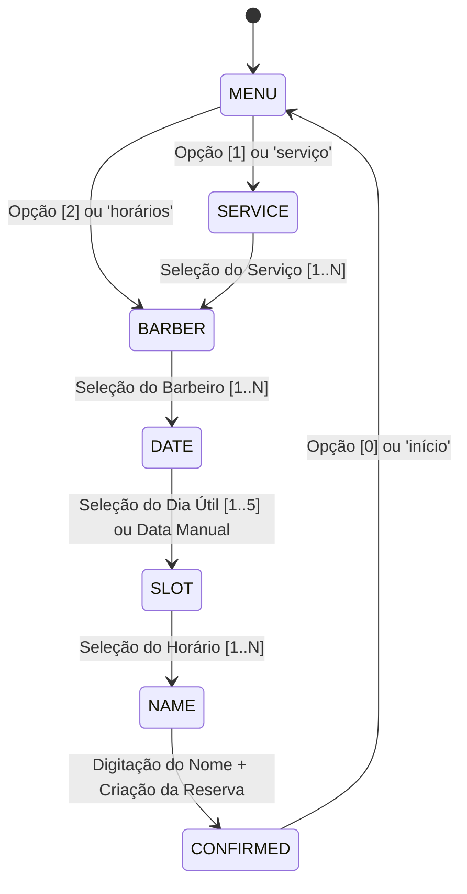

# 💈 Barbershop Appointment System (n8n + Google Gemini + Google Workspace)

Sistema completo de autoatendimento conversacional e agendamento em tempo real para barbearias, integrando **Frontend Web responsivo (estilo WhatsApp Web)**, **n8n Workflow Automation**, **Google Calendar API**, **Google Sheets API** e **Google Gemini 1.5 Flash (via LangChain)**.

> 🚀 **Demonstração Online em Tempo Real (Live Demo):**  
> Acesse e teste a interface interativa diretamente no seu navegador: [**https://luizenh0.github.io/barbershop-appointment-n8n/frontend/**](https://luizenh0.github.io/barbershop-appointment-n8n/frontend/)  
>  
> 📄 **Documentação Técnica Completa:**  
> O relatório detalhado de arquitetura, máquina de estados, engenharia de prompts e fórmulas matriciais está disponível em: [**DOCUMENTACAO_PROJETO.md**](./DOCUMENTACAO_PROJETO.md).

---

## 1. Visão Geral da Arquitetura

O sistema adota uma arquitetura orientada a eventos e desacoplada em 4 camadas principais:



### Componentes:
1. **Frontend (`frontend/`):** SPA construída em HTML5, CSS3 moderno e Vanilla JavaScript (ES6+), operando como cliente WhatsApp Web com suporte a Markdown, sugestões rápidas (*chips* contextuais) e máquina de estados determinística.
2. **Backend / Orquestrador (`n8n`):** Workflow estruturado com 38 nós e 4 webhooks de entrada para controle transacional, cálculo de disponibilidade e roteamento com a IA.
3. **Google Calendar:** Agenda do profissional com cálculo em tempo real de ocupação, prevenção de sobreposição (*concurrency control*) e bloqueio de folgas.
4. **Google Sheets:** Banco de dados tabular para leitura de serviços e barbeiros e registro analítico de agendamentos.
5. **Google Gemini 1.5 Flash:** LLM orquestrada via LangChain para condução de atendimento em linguagem natural com injeção contextual em tempo real.

---

## 2. Demonstração Visual do Sistema

> 🌐 **Acesse a aplicação ao vivo agora:** [**https://luizenh0.github.io/barbershop-appointment-n8n/frontend/**](https://luizenh0.github.io/barbershop-appointment-n8n/frontend/)  
> *(Interface web interativa com simulação inteligente de atendimento conversacional via WhatsApp Web)*

### 2.1. Jornada do Cliente no Frontend (Fluxo Completo em 3 Etapas)

| 1. Serviços e Preços | 2. Barbeiro, 5 Dias Úteis e Horários | 3. Confirmação e Comprovante |
| :---: | :---: | :---: |
|  |  |  |
| *Boas-vindas e catálogo com preços e durações lidos da planilha* | *Filtro inteligente de 5 dias de expediente (sem folgas) e slots livres* | *Resumo limpo com titularidade e Código de Reserva #IMP-XXXX* |

### 2.2. Backend, Orquestração no n8n e Google Workspace

| Workflow Geral no n8n (38 Nós) | Agente Gemini 1.5 Flash (LangChain) |
| :---: | :---: |
|  |  |
| *Integração de Webhooks, Calendar, Sheets e LLM* | *Injeção de catálogo dinâmico no System Prompt* |

| Agendamento no Google Calendar | Google Sheets (Aba summary) | Google Sheets (Aba Últimas Reservas) |
| :---: | :---: | :---: |
|  |  |  |
| *Reserva bloqueando horários em tempo real* | *Registro bruto gerado pelo n8n via append* | *Fórmula matricial =LET com última reserva na linha 2* |

---

## 3. Fluxo Funcional e Máquina de Estados

O agendamento segue uma máquina de estados finitos estrita para garantir consistência operacional:



### Detalhamento das Etapas:
* **`MENU`:** Exibe opções de abertura `[1] Serviços e Preços`, `[2] Ver Horários`, `[3] Agendar`.
* **`SERVICE`:** Apresenta lista dinâmica lida da aba `servicos` com nome, duração em minutos e valor em reais.
* **`BARBER`:** Apresenta os barbeiros ativos da aba `barbers`, listando dias de expediente e horários de cada um, além da opção `Sem preferência`.
* **`DATE` (Seleção Inteligente de Dias Úteis):**
  * Consulta os dias de atendimento do barbeiro selecionado (`barber.days`).
  * Apresenta exatamente os **5 próximos dias úteis em que o profissional atende**, pulando automaticamente folgas (ex: sábados e domingos para quem atende seg-sex).
  * Se o cliente interagir após as 18:00 (fim do expediente no fuso local), a lista inicia automaticamente a partir do próximo dia útil.
  * Suporta digitação livre de datas (`DD/MM`, `DD/MM/AAAA` ou `YYYY-MM-DD`) com validação de datas passadas e bloqueio preventivo de dias de folga.
* **`SLOT` (Cálculo em Tempo Real):**
  * Chama o endpoint `POST /available-slots`.
  * Divide a janela de atendimento em blocos de 30 minutos e confronta cada bloco com a agenda do Google Calendar.
  * Exibe apenas os horários livres.
* **`NAME`:** Coleta o nome do cliente para titularidade da reserva.
* **`CONFIRMED`:**
  * Realiza revalidação imediata (*anti-collision check*) para impedir reservas concorrentes no mesmo segundo.
  * Dispara `POST /book-appointment`.
  * Cria o evento na agenda do Google e grava na planilha.
  * Exibe confirmação limpa com o Código da Reserva (`#IMP-XXXX`).

---

## 4. Especificação dos Webhooks do Backend (n8n)

Todos os endpoints operam sob a base `http://<n8n-host>:5678/webhook` e utilizam o fuso horário padrão **`America/Sao_Paulo` (UTC-03:00)**:

| Endpoint | Método | Descrição | Payload de Entrada | Payload de Saída Principal |
| :--- | :--- | :--- | :--- | :--- |
| `/booking-options` | `GET` | Retorna catálogo de serviços e profissionais ativos com regras de expediente | N/A | `{ status: 'ok', timezone, barbers: [...], services: [...] }` |
| `/available-slots` | `POST` | Calcula slots livres de um profissional em uma data específica | `{ date: 'YYYY-MM-DD', barber: 'Juvenal', service: 'Corte' }` | `{ status: 'ok', date, barber, duration, slots: [{ label, startTime, endTime }] }` |
| `/book-appointment` | `POST` | Reserva o horário no Calendar e grava log na planilha | `{ name, barber, service, startTime, endTime, summary, number }` | `{ status: 'booked', eventId, calendarId, sheetLogged: true }` |
| `/agent-chat` | `POST` | Roteia mensagens em linguagem natural pelo LangChain + Gemini | `{ message: 'Olá', sessionId: '...' }` | `{ response: '...' }` |

---

## 5. Estrutura do Banco de Dados Tabular (Google Sheets)

A planilha Google atua como banco relacional leve com 4 abas estruturadas:

### 1. Aba `barbers` (Cadastro de Profissionais)
| Coluna | Tipo | Descrição | Exemplo |
| :--- | :--- | :--- | :--- |
| `barber` | String | Nome identificador do barbeiro | `Juvenal` |
| `calendarId` | String | ID da agenda Google Calendar ou e-mail | `agenda.juvenal@barbeariaimperial.com` |
| `dias` | String | Intervalo ou lista de dias de atendimento | `seg-sex` ou `ter,qui,sab` |
| `inicio` | String | Horário de abertura do expediente | `09:00` |
| `fim` | String | Horário de encerramento do expediente | `18:00` |
| `ativo` | String | Flag de ativação no sistema | `sim` |

### 2. Aba `servicos` (Catálogo de Atendimento)
| Coluna | Tipo | Descrição | Exemplo |
| :--- | :--- | :--- | :--- |
| `servico` | String | Nome comercial do serviço | `Corte Simples` |
| `duracao` | Integer | Duração em minutos | `30` |
| `preco` | Number | Valor em reais | `50` |
| `ativo` | String | Flag de ativação no catálogo | `sim` |

### 3. Aba `summary` (Histórico Bruto de Transações)
Recebe os registros inseridos pelo nó Google Sheets do n8n via operação `append`:
`status` | `barber` | `name` | `service` | `startTime` | `endTime` | `summary`

### 4. Aba `Últimas Reservas` (Dashboard Ordenado em Tempo Real)
Para garantir que a última reserva fique **sempre na linha 2** com data e hora separadas e limpas, a aba utiliza a fórmula matricial na célula **A2**:
```excel
=LET(dados; SORT(FILTER(summary!A2:G; summary!C2:C<>""); FILTER(LIN(summary!A2:A); summary!C2:C<>""); FALSO); nomes; CHOOSECOLS(dados; 3); servicos; CHOOSECOLS(dados; 4); barbeiros; CHOOSECOLS(dados; 2); datasHoras; CHOOSECOLS(dados; 5); datas; MAP(datasHoras; LAMBDA(dh; EXT.TEXTO(dh; 9; 2) & "/" & EXT.TEXTO(dh; 6; 2) & "/" & EXT.TEXTO(dh; 1; 4))); horas; MAP(datasHoras; LAMBDA(dh; EXT.TEXTO(dh; 12; 5))); HSTACK(nomes; servicos; barbeiros; datas; horas))
```
* **Colunas geradas:** `Cliente` | `Serviços` | `Barbeiro` | `Data` (`DD/MM/AAAA`) | `Horário` (`HH:mm`).

---

## 6. Estrutura do Repositório

```text
barbershop-appointment-n8n/
├── docs/
│   └── screenshots/     # Imagens demonstrativas para a documentação e README
│       └── README.md    # Guia com lista de imagens e orientações de captura
├── frontend/
│   ├── index.html       # Interface SPA estilo WhatsApp Web Dark Theme
│   ├── styles.css       # Folha de estilos responsiva com tokens do WhatsApp
│   ├── app.js           # Máquina de estados, parser Markdown e integração de API
│   └── config.js        # Parâmetros de ambiente (URL n8n, timezone e USE_MOCK)
├── workflow-completo-barbearia.json   # Exportação JSON do fluxo n8n (38 nós)
├── DOCUMENTACAO_PROJETO.md            # Documentação técnica e acadêmica completa
├── README.md                          # Visão geral e especificação do sistema
├── index.html                         # Redirecionador raiz para ./frontend/
└── .gitignore                         # Exclusão de arquivos locais e temporários
```

---

## 7. Instalação e Execução

### Pré-requisitos:
* Instância do n8n instalada e em execução (porta padrão `5678`).
* Conta Google com Google Sheets e Google Calendar habilitados.
* Chave de API Google Gemini (obtida gratuitamente no [Google AI Studio](https://aistudio.google.com/)).

### Passo a Passo:
1. **Importação do Workflow:**
   * No n8n, acesse **Workflows** ➔ **Import from File** e selecione `workflow-completo-barbearia.json`.
   * Configure as credenciais nos nós correspondentes:
     * `Google Sheets OAuth2 API`
     * `Google Calendar OAuth2 API`
     * `Google Gemini Chat Model`
   * Clique em **Publish / Active**.
2. **Configuração do Frontend:**
   * No arquivo `frontend/config.js`, defina a URL do seu n8n:
     ```javascript
     N8N_BASE_URL: 'http://localhost:5678/webhook',
     USE_MOCK: false,
     TIMEZONE: 'America/Sao_Paulo'
     ```
3. **Execução:**
   * Abra `frontend/index.html` em qualquer navegador ou publique via **GitHub Pages**. Com `USE_MOCK: true`, o frontend pode ser executado em modo de demonstração independente de servidor ativo.

---

## 8. Referências Técnicas e Bibliográficas

Este projeto foi fundamentado em padrões consolidados de engenharia de software, inteligência artificial generativa e integração de APIs em nuvem:

### Inteligência Artificial e Modelos de Linguagem
1. **Google DeepMind (2024).** *Gemini 1.5: Unlocking Multimodal Understanding Across Millions of Tokens of Context*. Technical Report / arXiv:2403.05530. Disponível em: [arXiv](https://arxiv.org/abs/2403.05530).
2. **Chase, H. et al. (2023).** *LangChain: Framework for Developing Applications Powered by Language Models*. Documentação Oficial. Disponível em: [docs.langchain.com](https://docs.langchain.com).
3. **Brown, T. B. et al. (2020).** *Language Models are Few-Shot Learners*. Advances in Neural Information Processing Systems (NeurIPS 2020).
4. **Schulman, J. et al. (2022).** *Prompt Engineering Guidelines for Generative Pre-trained Models*. OpenAI Research.

### Orquestração de Workflows e Integrações
5. **n8n Community (2024).** *n8n Documentation: Workflow Automation and Advanced LangChain Cluster Nodes*. Disponível em: [docs.n8n.io](https://docs.n8n.io).
6. **Fielding, R. T. (2000).** *Architectural Styles and the Design of Network-based Software Architectures (REST)*. Doctoral Dissertation, University of California, Irvine.

### Serviços de Nuvem e Padrões de Calendário
7. **Google Cloud Developers (2024).** *Google Calendar API v3: Events, Concurrency & Freebusy Resources*. Disponível em: [developers.google.com/calendar](https://developers.google.com/calendar).
8. **Google Cloud Developers (2024).** *Google Sheets API v4: Append Values & Data Manipulation*. Disponível em: [developers.google.com/sheets](https://developers.google.com/sheets).
9. **Internet Engineering Task Force (IETF) RFC 5545.** *Internet Calendaring and Scheduling Core Object Specification (iCalendar)*. Disponível em: [rfc-editor.org/rfc/rfc5545](https://www.rfc-editor.org/rfc/rfc5545).

### Arquitetura de Interface e UX Conversacional
10. **Gamma, E., Helm, R., Johnson, R., & Vlissides, J. (1994).** *Design Patterns: Elements of Reusable Object-Oriented Software (Finite State Machine / State Pattern)*. Addison-Wesley.
11. **Nielsen, J. (1994).** *Heuristic Evaluation of User Interfaces and Conversational Friction Reduction*. Nielsen Norman Group.
